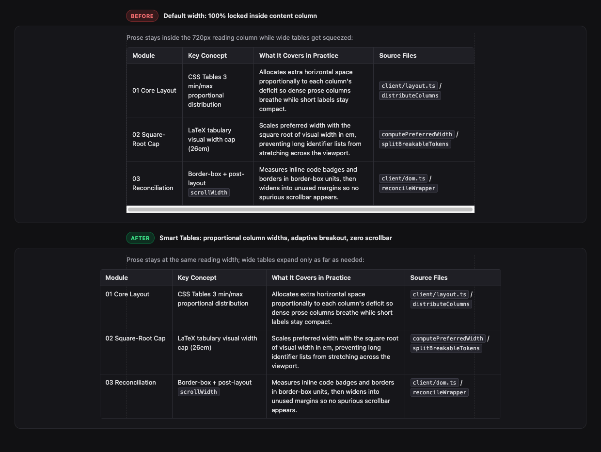

# paseo-smart-tables

Smart proportional column widths and adaptive breakout for Markdown tables in Paseo desktop and web.



## Why

Paseo constrains chat and Markdown file previews to a readable content width (default 820px), and renders Markdown tables with `width: 100%`. On wide tables with mixed CJK text, prose, and long identifiers:

- Automatic browser table layout lets unbreakable tokens squeeze CJK columns down to a few characters per line.
- Blindly stretching every table to full pane width makes short 2-column tables look sparse and awkward.
- Content-box cell sizing or inline `<code>` pills can leave an unnecessary horizontal scrollbar even when plenty of margin remains.

## How it works

1. **Short tables stay inside the content column**: If the table's natural width (with columns capped at `26em`) fits inside the host column, it renders compactly at its natural width without breaking out.
2. **Proportional column sizing**: Wider tables allocate space using two standard layout models:
   - **CSS Tables 3** (`TableLayoutAlgorithmAuto` deficit distribution): surplus width above each column's minimum breakable token width is distributed proportionally to `(max - min)`.
   - **LaTeX `tabulary` square-root cap**: preferred column width scales with `em * (3 + 2.1 * sqrt(contentEm)) + pad` up to `26em`, so text-heavy columns get more room without letting a single long filename list take over the table.
3. **Adaptive breakout**: Wide tables expand symmetrically out of the content column only as wide as needed, stopping inside a `12px` gutter on each side of the enclosing scroll pane. Only tables whose minimum width exceeds the entire pane scroll horizontally.
4. **Border-box + `scrollWidth` reconciliation**: `table`, `th`, and `td` use `box-sizing: border-box`, and a post-layout check widens the wrapper up to the pane gutter whenever inline `<code>` badges, bold headers, or math formulas render wider than estimated.
5. **Streaming & clean teardown**: Tracks streaming Markdown updates (`MutationObserver`) and pane resizes (`ResizeObserver`). All rules live in a dedicated `<style data-paseo-smart-tables>` sheet rather than mutating React-managed inline styles, and unloading the plugin cleanly removes all styles and observers.

## Scope

- Works on Paseo Desktop (Electron) and Web.
- Safely no-ops on iOS and Android native clients.
- Zero runtime dependencies, zero server child process, zero network or filesystem access.

## Development

```bash
npm install
npm run typecheck
npm test
```

## License

MIT
